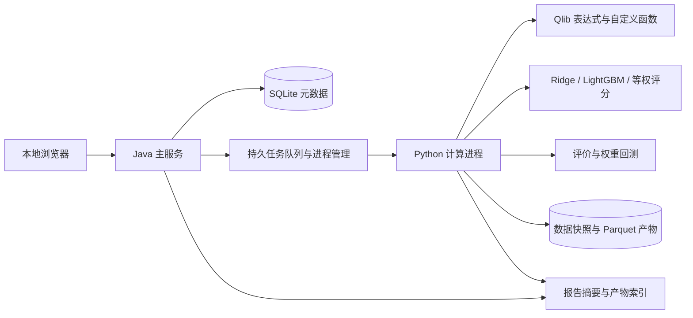

# A 股多因子投研平台开发计划书

版本：1.0，2026-09-17。状态：用户已确认技术方案与交付计划，并授权开始开发及子代理并行协作。

本文件保留开发前约定，不把计划项当作已完成功能。实际交付、测试和限制见 [实施状态](implementation-status.md)。

配套文件：

- [需求访谈与来源记录](requirements-and-research.md)
- [量化计算与数据契约](quantitative-contract-v1.md)
- [验收矩阵与验证方案](acceptance-matrix-v1.md)

## 1. 产品目标与成功标准

为个人研究提供一套可维护的本地工具，完成：选择股票池与时间范围 → 编写或导入因子 → 评价单因子 → 组合特征 → 比较模型 → 扣除假设成本的权重回测 → 保存和复现实验。

平台主体采用 Java；研究计算使用 Python。浏览器是主要操作界面，Python 函数与算子在本地 IDE 中维护。项目使用免费依赖和符合来源条款的免费研究数据。

成功标准是计算有明确口径、完整流程可以运行、结果能够追溯和复现、用户能够自行增加因子和模型。策略盈利或某类模型胜出不是软件验收条件。

## 2. 已确认的首版范围

| 领域 | 首版决定 |
| --- | --- |
| 用户与运行方式 | 个人、本地 Windows、浏览器访问、单机运行，由用户主要维护 |
| 市场与数据 | A 股日频量价；初始约 100 只股票，2021—2025 年；另取计算所需前后缓冲 |
| 数据入口 | BaoStock 优先候选，AKShare 补充候选，本地 CSV/Parquet 导入及可替换供应商接口 |
| 因子开发 | 导入 Qlib 表达式；浏览器编辑公式；本地 Python 因子与自定义算子；版本管理 |
| 单因子评价 | 未来 1/5/10/20 个交易日；5 组；预测、分层、持续性、成本、风险、互补性与稳健性报告 |
| 参考组合 | 按预设方向选前 20%，等权、多头、可持现金、无杠杆；每日与每 5 个交易日调仓 |
| 模型 | 等权因子评分、Ridge、LightGBM；统一扩展接口，后续可接入深度学习 |
| 模型标签 | 默认未来 5 个交易日收益，可切换为 1/10/20 日 |
| 数据切分 | 固定训练、验证、最终测试；默认 2021—2023 / 2024 / 2025 |
| 回测 | 理论持仓权重与收益计算；收盘形成信号，下一交易日开盘调整，开盘到开盘核算 |
| 成本 | 买卖各 10 bps；敏感性情景为 0/5/10/20 bps；首次建仓计费、期末不强制清仓、现金收益为 0 |
| 调参 | 手动配置、复制实验、比较结果；记录所有运行版本 |
| 基准 | 沪深 300 与相同股票池等权组合；明确各自收益口径 |
| 下一版重点 | 滚动训练、滚动验证、样本外预测拼接及模型比较 |

首版交付边界：不包含订单簿或订单撮合、券商接入、真实交易、融资融券、逐笔/分钟级处理、财务/PIT 因子、自动搜参、GPU 训练、多人权限和云部署。权重回测不承诺现实交易可实现性。

## 3. 产品页面与完整操作流程

| 页面 | 核心功能 | 输出 |
| --- | --- | --- |
| 数据与股票池 | 新建股票池、代码列表导入、选择日期、下载/导入、查看字段与质量检查、冻结快照 | 数据快照及股票池版本 |
| 因子库 | Qlib 公式编辑与批量导入、Python 因子发现、参数、方向、依赖字段、算子文档、样例预览 | 不可变的因子版本 |
| 单因子分析 | 选择评价模板、运行任务、查看 IC/分组/衰减/换手/参考组合表现 | 单因子报告及底层结果表 |
| 实验工作台 | 选择同一组因子、模型、标签、时间切分、手动参数，复制已有实验 | 实验配置、预测分数和模型产物 |
| 回测与比较 | 查看毛/净收益、基准、回撤、理论换手、成本情景；比较同口径实验 | 比较表、曲线、指标定义 |
| 任务与运行记录 | 队列、进度、日志、取消、失败原因、重跑、数据/代码版本 | 可追溯的任务记录 |

界面默认中文；指标保留 IC、Rank IC 等常用缩写，并提供中文解释与公式提示。首版提供 CSV/JSON 导出和自包含 HTML 报告；不依赖 Notebook 才能查看结果。

第一次使用提供一个示例股票池、10 个可解释的量价因子、一份分析模板和三种模型配置。示例因子包括动量、反转、波动、振幅、量比、量的稳定性和价量相关；其方向只是可修改的实验配置，不表示已证明盈利。

## 4. 系统架构

采用模块化 Java 单体服务配合 Python 计算子进程。开发时前端使用开发服务器；交付时静态资源打入 Java 应用，由同一个本地入口提供页面和 API。



### 4.1 技术栈候选与锁定方式

| 层次 | 选择 | 目的与验证条件 |
| --- | --- | --- |
| Java | Java 21、Spring Boot 4.1.x、Maven Wrapper 3.9.x | API、任务、版本、元数据、打包；官方当前声明的兼容范围包含 Java 21 |
| 前端 | React、TypeScript、Vite、ECharts | 表单、代码编辑、图表和报告；联合锁定依赖版本 |
| 元数据 | SQLite + Xerial JDBC，Spring JDBC，版本化 SQL 迁移 | 无独立数据库服务；由 Java 单一入口写元数据，减少并发写复杂性 |
| Python | 项目专属 CPython 3.12 x64 虚拟环境 | 不直接修改应用附带或系统共享 Python 环境 |
| 研究库 | pyqlib 0.9.7 候选、NumPy、pandas、scikit-learn、LightGBM 4.x CPU、Alphalens-reloaded，联合锁定确切版本 | Qlib 负责表达式；模型和评价经平台适配层接入 |
| 数据文件 | Parquet/PyArrow、JSON manifest、CSV 导入导出 | 行情与结果不逐行放进元数据库；保留可移植文件 |
| 验证 | JUnit、pytest、前端基础测试及浏览器完整流程验证 | 重点覆盖计算、数据时间边界、任务异常和用户流程 |

官方文档/发行页为版本候选提供依据，不代表本机安装已通过。M0 锁定确切补丁、传递依赖和运行时版本；Python 3.12 联合依赖验证失败时，记录原因后可采用 3.11 兼容环境，不改变产品需求。

Java 和 Python 只保留一份量化计算实现，位于 Python；Java 不另行重写指标。前端不自行计算财务结果。元数据和报告保存统一的指标版本。

### 4.2 模块职责

| Java 模块 | 职责 |
| --- | --- |
| data | 供应商配置、股票池、快照注册、数据质量摘要 |
| factor | 因子定义、版本、参数、算子目录与校验结果 |
| experiment | 模型配置、特征集、切分、实验比较与复现信息 |
| job | 持久队列、进程启动、日志、取消、失败恢复、产物登记 |
| report | 指标摘要、图表数据、分页、导出和下载 |
| infrastructure | 数据库迁移、项目配置、文件路径、进程协议、运行诊断 |

Python 包划分为 providers、datasets、expressions、plugins、features、models、evaluation、backtest、artifacts、worker。框架相关调用放在 adapter 中，业务记录不直接依赖 Qlib 内部对象序列化格式。

### 4.3 任务协议与异常处理

- Java 为每个任务创建唯一运行目录和 `job.json`，通过参数数组启动 Python，不将表达式或路径拼成 shell 命令。
- 任务类型覆盖数据导入、因子预览、因子分析、模型实验、回测、报告导出。
- Python 的 stdout 输出带版本、序号的 JSONL 事件：开始、进度、日志、产物、完成或错误；stderr 保存诊断信息。
- 状态为 QUEUED、RUNNING、SUCCEEDED、FAILED、CANCELLED、INTERRUPTED。应用重启后将未确认结束的运行标为 INTERRUPTED，不自动当作成功。
- 默认一个重型任务同时运行；模型 CPU 线程默认 4，可配置。取消先请求正常退出，再终止本任务子进程。
- 产物先写临时文件，校验后原子登记；失败文件不作为有效缓存。日志能够显示来源、股票、日期和错误类型。
- 行情下载使用超时、有限重试、退避和缓存；不绕过来源限制。计算失败默认由用户明确重跑。

## 5. 数据方案

### 5.1 接入优先级与数据门槛

1. M0 用单股票短区间验证 BaoStock 的连接、字段、单位与价格。
2. 扩展到少量股票，覆盖停牌、零成交量和除权附近样本；AKShare 用作候选补充与少量交叉核验。
3. 验证复权因子/原始价量可还原后，获取约 100 只股票的完整研究快照。
4. 同时提供本地 CSV/Parquet 入口，使用相同质量校验与快照协议。

当前没有已通过实测的数据源。此前小请求被本地网络权限阻止，不能据此认定供应商失效。若批准开发后仍找不到可取得、可使用的数据，必须明确汇报；可以继续用标注清楚的合成样本验证算法，但不能把真实数据功能标为验收通过。

默认样本池是固定研究样本，可通过代码列表修改。选择过程保存股票清单、获取时点、随机种子或排序规则；不依据回测期收益筛选股票。未验证历史退市覆盖时，报告标注幸存者偏差，不能把当下指数成分解释为当年的真实成分。

### 5.2 数据组织

原始层保存供应商字段与响应、下载时间和来源；标准层统一交易日、证券代码、币种、股数、金额与原始 OHLC；研究层生成复权价格、Qlib 价量视图、估值视图和质量掩码。每层有独立 schema/version/hash。

数据快照不可原地更新。追加或修复生成新快照，历史实验继续引用旧快照。归一化基准固定在快照清单中；算子、特征与模型缓存包含快照和代码版本。

具体字段、复权、VWAP、停牌、缺失、切分规则见[计算契约](quantitative-contract-v1.md)。其中：

- VWAP 只有在成交金额与股数单位明确后才能派生，不能以 OHLC 平均值代替。
- 未知缺失不能填成零收益；确认停牌可延续估值，相关调仓整体跳过并记录。
- 首版不模拟涨跌停、成交量容量、整手交易和订单成交；报告显示此范围。
- 股票复权价格收益与沪深 300 价格指数可能存在分红口径差异，必须展示；同池等权基准采用与策略完全相同的价格视图。

## 6. 因子与 Qlib 兼容方案

Python 进程复用固定版本 Qlib 表达式引擎，不另外实现一个声称兼容的近似解释器。

首版导入单条公式、命名公式列表和参数化公式；保留 `$close`、`Ref`、`Rank` 等 Qlib 命名与语义。兼容验收以有限正窗口的核心量价算子、全部默认 Alpha158 表达式，以及自定义算子样本为准。支持清单在界面和文档中可见。

Qlib 的 `Rank` 是时序排名；`Ref(x,0)`、零窗口、EMA 等历史边界需专项验证，首版未通过验证的算子或参数明确拒绝，不返回近似值。该范围不承诺任意 Qlib 配置文件或其他用户的完整 Python 环境都能导入。

表达式先经过语法树、字段和算子校验，再交给 Qlib。特征禁止未来依赖；未来收益由独立标签模块生成。新增算子不能覆盖内置名称。截面函数使用面板接口，与 Qlib 单证券时序算子区分。

Python 插件需声明名称、版本、字段、回看期、参数与输出契约。导入时记录代码哈希，运行时冻结副本；修改代码不影响已有实验。自定义 Python 是本机可信代码执行，不宣称提供隔离恶意代码的安全沙箱。

## 7. 单因子评价与模型实验

单因子报告包括：覆盖和分布、Pearson/Rank IC、ICIR、分组收益与单调性、1/5/10/20 日衰减、排名自相关、成员换手、参考组合净值与回撤、理论资金换手与费用、成本敏感性、因子值和收益相关性。

从因子库选择多个因子后，还可建立加入/移除某因子的对照实验，衡量样本外增量贡献。比较必须使用相同数据、股票池、切分、成本与模型配置；不同协议的结果可以浏览，但不会被标为直接可比。

默认预处理对每个日期的已知截面做轻度极值裁剪和标准化；具体参数写入实验。常数、缺失和不足样本有明确标记。三种模型使用相同特征行和标签：

| 模型 | 首版行为 |
| --- | --- |
| 等权评分 | 按冻结的方向对标准化因子求等权平均，不需要拟合 |
| Ridge | scikit-learn Ridge，默认 alpha=1.0，可手动修改；保存系数与预处理信息 |
| LightGBM | CPU 回归，提供少量清晰参数、固定种子和确定性配置；保存模型与重要性 |

默认 LightGBM 起始配置为 300 棵树、learning_rate=0.05、num_leaves=15、min_child_samples=50，最终参数名由锁定版本适配并记录；这些是工程基线，不是优化结论。

验证集用于参数取舍；最终测试结果单独呈现。查看最终测试不会使其成为新的训练输入，但系统记录测试集已被查看，避免把反复查看后的选择称为全新盲测。首版不自动搜索参数。

## 8. 权重回测与费用

信号日为 t，理论调仓时点为下一交易日开盘；单日收益区间为该开盘至再下一交易日开盘。实际参考组合按每日或每 5 个交易日重设权重，其间权重随价格漂移。

资金换手由调仓前漂移后的权重与新目标权重计算。首次建仓计费，现金不计换手，末日持仓按估值结算且不收取虚构平仓费。成本通过资金守恒方程扣减，避免目标股票权重已占满资金却另行制造负现金。

同时报告毛收益和净收益；0/5/10/20 bps 情景分别计算。因子成员换手、双边资金换手和半双边口径分别命名。详细公式、零成本例子与费用例子见计算契约及验收矩阵。

持仓与收益属于复权价格上的理论份额计算。确认停牌时沿用最后有效估值，并跳过涉及停牌证券的整次调仓；一般未知缺失会阻止生成完整有效回测。该最小数据处理不构成订单撮合或交易可实现性验证。

## 9. 数据实体与接口边界

| 实体 | 主要信息 |
| --- | --- |
| UniverseVersion | 证券清单、选取说明、版本、哈希 |
| DataSnapshot | 来源、区间、日历、schema、复权与归一化基准、质量报告、文件清单 |
| OperatorVersion / FactorVersion | 表达式或插件引用、代码哈希、字段、参数、窗口、方向、可用状态 |
| FeatureSet / LabelSpec / SplitSpec | 有序特征、预处理、标签起止时间、区间与隔离规则 |
| ExperimentSpec | 模型类型、参数、种子、资源限制、参考组合与费用配置 |
| Run / Artifact / Metric | 状态、日志、父实验、环境清单、结果文件、指标定义版本 |

REST API 按 `/api/data`、`/api/universes`、`/api/factors`、`/api/operators`、`/api/experiments`、`/api/jobs`、`/api/reports` 划分。所有长任务返回 job_id；任务进度采用同源 SSE，断线可回查状态。

Java 读取小型 JSON 摘要并提供报告接口；大表保留 Parquet，按需要由 worker 生成分页或导出产物。图表抽样不影响用于计算指标的原始结果。

## 10. 可复现、运行与维护

每次运行保存数据与股票池哈希、因子/算子代码、参数、模型配置、标签、切分、成本、种子、指标版本、依赖锁文件与机器/线程信息。同环境重跑要求达到规定的数值容差；跨硬件不承诺逐位相同。

交付包含启动/停止/诊断脚本、构建说明、环境准备说明、插件开发示例、常见数据错误说明和备份恢复步骤。日常使用不需要开发服务器；数据、模型和结果统一放在可配置工作目录。

应用默认仅绑定本机回环地址，限制跨站调用；文件访问限制在配置的项目和数据目录内。Python 插件可访问当前用户权限范围内的资源，用户应只运行自己信任的代码。

元数据库迁移前备份；快照与已登记产物不可静默覆盖。清理缓存与删除运行由界面列出影响范围后显式操作，避免误删被其他实验引用的数据。

建议目录：

```text
backend/                 Java 服务与测试
frontend/                浏览器界面
research/                Python 包与计算测试
plugins/factors/         用户 Python 因子
plugins/operators/       用户时序/截面算子
plugins/models/          模型扩展入口
contracts/               JSON schema 与协议版本
examples/                因子、模型、股票池与实验配置
scripts/                 本地构建、启动、停止、诊断
docs/                    计划、计算契约、验收与操作文档
workspace/               运行数据、快照、数据库、产物；不提交 Git
```

## 11. 分阶段开发与退出条件

以下为工作量估计，单位是单人有效工程日，不是自动运行承诺或交付日期；包含实现、检查、文档和返修。数据获取受外部条件影响，单独列出风险。

| 阶段 | 工作内容 | 可审阅交付物与退出条件 | 估计 |
| --- | --- | --- | --- |
| M0 环境与可行性 | 锁定依赖，验证 Java/Python/SQLite、Qlib 表达式、模型、Parquet、短区间真实数据 | 环境锁文件、数据探测报告、兼容矩阵；关键能力实测通过或明确阻塞 | 1–2 日 |
| M1 项目与任务基础 | Java 模块、数据库迁移、前端骨架、进程协议、队列/日志/取消 | 从网页启动一个计算任务并查看产物；失败与重启状态正确 | 2–3 日 |
| M2 数据与快照 | 供应商 adapter、文件导入、日历、单位、复权/Qlib 视图、质量检查、缓存 | 约 100 只股票目标区间的可追溯快照；问题与覆盖完整记录 | 3–5 日 |
| M3 因子开发 | Qlib 校验/兼容、自定义算子、Python 因子、版本、预览、10 个示例因子 | Alpha158 全表达式与插件样本通过；未来引用拒绝；追加未来数据不改历史输出 | 3–5 日 |
| M4 单因子与回测 | 标签、IC/分层/换手、漂移与费用、基准、敏感性、单因子页面 | 手工样例与独立参考一致；完整单因子报告和多成本情景 | 4–6 日 |
| M5 多因子与模型 | 共享特征/切分、等权/Ridge/LightGBM、版本化参数、模型保存 | 三模型同协议比较；标签隔离和重复运行通过 | 3–5 日 |
| M6 比较与报告 | 相关矩阵、增量对照、实验复制、报告导出、页面细节 | 一条完整浏览器流程；可下载报告与结果表 | 2–3 日 |
| M7 验收与交付 | 全套计算/集成/浏览器检查，性能记录，打包、维护文档 | 验收矩阵完成；清洁环境可启动；已知局限清楚列出 | 2–4 日 |

合计约 20–33 个有效工程日。阶段顺序为 M0 → M1 → M2 → M3 → M4 → M5 → M6 → M7。每阶段均提供可运行或可审阅结果；重大失败先修复，不将问题推到最终演示。

M4 是第一条完整研究闭环：数据 → 自定义因子 → 单因子报告 → 含成本回测。M5 完成三种模型比较。M7 才代表首版整体交付。

## 12. 验收与性能目标

详细验收编号见[验收矩阵](acceptance-matrix-v1.md)。核心门槛：

1. 手算样例证明收益时点、权重漂移、费用、首次建仓和末期估值正确。
2. 特征无未来引用、标签不跨训练/验证/测试边界、预处理不使用未来拟合数据。
3. Qlib 支持范围与全部 Alpha158 公式实际验证，自定义扩展有可运行示例。
4. 三模型共享数据协议且能够重复运行；失败不留下伪成功报告。
5. 真实数据样本成功获取并冻结，供应商、字段和质量有证据；合成样本不替代此项。
6. 用户能够通过浏览器完成从股票池到比较报告的全过程，并独立新增一个因子。

初始性能目标以本机冷/热缓存分别记录：缓存数据下单因子全报告不超过 60 秒；100 股、5 年、10 特征的三模型比较不超过 5 分钟；Alpha158 兼容计算不超过 5 分钟；一个重型任务峰值工作集目标不超过 4 GiB。报告摘要和任务列表热读取目标 1 秒内。网络下载时间不计入计算目标。

这些是待测目标，当前没有性能测量。若不达标，先定位瓶颈、降低数据复制与重复计算；不能在最终交付时静默改写目标。

## 13. 主要风险与处理

| 风险 | 处理与透明度 |
| --- | --- |
| 免费接口无法访问、限流或字段变更 | M0 实测；可替换 adapter、缓存和本地文件入口；缺数据则汇报，不伪造替代 |
| 复权、停牌、VWAP、退市历史不完整 | 明确质量状态、研究口径与无效区间；条件不足的能力不标为通过 |
| Qlib/科学计算依赖在 Windows 不兼容 | 使用已有 wheel 的候选组合并联合锁定；必要时采用 Python 3.11；不承诺所有上游示例可运行 |
| Qlib 表达式隐藏未来依赖或语义误解 | 白名单、窗口审查、追加未来数据不变性测试、官方结果比对 |
| 反复调参和查看测试集导致过拟合 | 保存全部实验、固定最终测试、显示已查看状态；不提供统一“合格收益”门槛 |
| 简化回测夸大现实交易可行性 | 标明理论权重、缺少撮合/容量/涨跌停约束、假设费用和样本池偏差 |
| 项目过大难以维护 | Java 单体、Python 单一计算实现、固定协议、适配边界、分阶段交付 |

## 14. 下一版：滚动训练专项

首版预留 FoldSpec、ModelAdapter、PredictionArtifact、as_of 与 label_end 元数据，避免后续重写时间边界，但不交付滚动调度。

下一版优先实现：

1. 固定长度滚动窗与扩展窗，按月/季或指定交易日重训。
2. 每折训练/验证/预测边界与标签隔离，预处理器和模型只在该折可见数据上拟合。
3. 将互不重叠的样本外预测拼成一条连续分数序列，再进行一次连续持仓回测；不按折重置资金或省略换手费用。
4. 保存每折模型、训练范围、耗时、漂移与性能；比较线性、树模型及后续神经网络。
5. 验证重训频率、模型陈旧程度、交易成本与收益的关系。

滚动训练验收通过后，再讨论自动搜参和更复杂模型，保持样本外评价协议一致。

## 15. 计划确认与开始条件

用户已确认 Q1—Q27 的业务选择。本计划将其转化为可执行的工程方案，新增的默认参数、最小数据处理规则和验收条件均在文档中显式列出。

本计划整体确认后，从 M0 开始开发。若出现需要改变已确认产品范围、使用付费服务或放宽核心正确性要求的情况，提出具体变更；常规实现选择由开发过程自行完成并记录。

## 16. 主要技术依据

- [Spring Boot 系统要求](https://docs.spring.io/spring-boot/system-requirements.html)：Java 与构建工具兼容范围。
- [Vite 入门](https://vite.dev/guide/)：前端模板及 Node 基础要求。
- [Apache ECharts](https://echarts.apache.org/en/index.html)：浏览器图表能力。
- [Qlib 发行页](https://pypi.org/project/pyqlib/)与[表达式源码](https://github.com/microsoft/qlib/blob/main/qlib/data/ops.py)：Windows 包、表达式语义与窗口接口。
- [Qlib 模型接口](https://qlib.readthedocs.io/en/latest/component/model.html)：可扩展训练/预测协议。
- [LightGBM 发行页](https://pypi.org/project/lightgbm/)与[参数文档](https://lightgbm.readthedocs.io/en/stable/Parameters.html)：CPU 训练依赖与参数。
- [Ridge 文档](https://scikit-learn.org/stable/modules/generated/sklearn.linear_model.Ridge.html)：线性模型实现依据。
- [SQLite JDBC](https://github.com/xerial/sqlite-jdbc)、[PyArrow 安装说明](https://arrow.apache.org/docs/python/install.html)：本地存储依赖。
- 书籍、Alphalens、数据源依据见需求与研究记录；引用只支持相关能力或语义，不构成当前项目已验证的证据。
